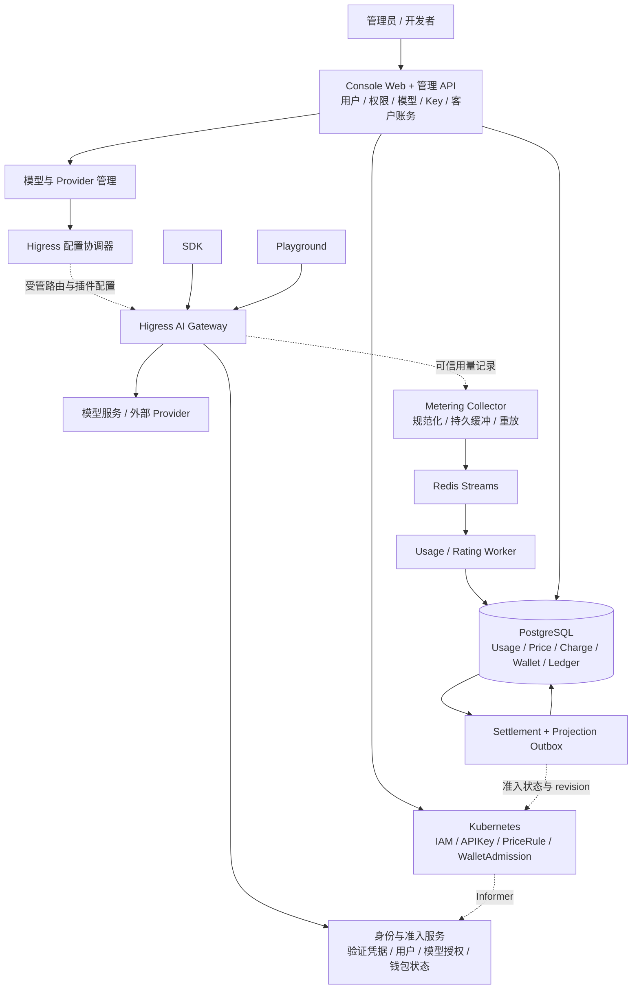

# Console 与 Higress 总体架构

2026-11-20。方向已确定：Higress 替代自研推理网关；本文是目标架构，接入代码实施见 [Higress 接入合同](higress-integration.md)，尚未切流部署。

## 1. 背景与目标

当前 Console 同时承担管理 API、API Key 鉴权、推理路由、SSE 观察和计费事件生产。目标改成接近 Global 的分层：Console 管平台，Higress 管推理流量，独立服务管计量与账务。

| 目标 | 验证结果 |
| --- | --- |
| 停止维护自研推理代理 | SDK 与 Playground 都经 Higress，不再经过 `internal/router` 的推理转发 |
| 管理与推理解耦 | 管理 API 重启不要求重启 Higress；明确独立鉴权服务的可用性依赖 |
| 保留既有资金事实 | 用户钱包、充值、不可变价格、Charge、Ledger 和历史请求继续可查 |
| 凭据与用户兼容 | 现有摘要 Key、canonical UID、SDK/session 区分及禁用规则保留 |
| 用量可追溯 | 一次调用能关联可信主体、模型、上游 usage、价格、扣款和准入版本 |

非目标：复制 Global 全部产品能力、改用其完整存储栈、重写用户体系或扩展资源计费。分批接入 Higress，计费验收通过后再切换付费流量。

## 2. 总体架构



### 三条链路

```text
管理：浏览器 -> Console API -> IAM / 模型配置 / 钱包与流水
推理：SDK 或 Playground -> Higress -> 模型服务
计费：Higress -> Collector -> Redis -> Usage/Rating -> Settlement -> Ledger
反馈：Ledger 事务 -> Outbox -> WalletAdmission -> 身份与准入服务
```

身份与准入服务是推理同步依赖，但不转发模型响应、不解析 SSE，也不执行资金事务。Console BFF 的管理 API 代理仍保留，不再承担生成流量。

## 3. 组件与责任

| 组件 | 负责 | 不负责 |
| --- | --- | --- |
| Console | 登录、IAM、API Key 管理、模型管理、价格、充值、用量与账单查询 | 推理代理、流式解析、Provider 重试 |
| 配置协调器 | 将平台模型/Provider/策略编译为受管 Higress 配置，报告协调结果 | 模型生成、余额扣减 |
| Higress | 协议代理、路由、模型映射、超时、限流与观测 | 用户资金事实、充值、正式账本 |
| 身份与准入服务 | 从缓存验证 Key/会话、用户有效性、模型权限、独立钱包准入 | 模型转发、每请求查 PG 或写 K8s |
| Collector | 校验可信记录、生成稳定事实身份、持久缓冲、投递与重放 | 估算缺失 Token、按日志直接改余额 |
| Usage/Rating Worker | 用量归一化、完整性判断、不可变价格归档和计价 | 推理路由和钱包准入决定 |
| Settlement Worker | 幂等结算、Ledger 与钱包事务、准入 Outbox | 从 Prometheus 指标推算费用 |
| Kubernetes | 身份、策略和准入投影；Higress 配置分发 | 正式钱包/流水存储 |
| PostgreSQL | 用量、价格历史、Charge、钱包、Ledger、投影恢复事实 | 网关逐请求认证热路径 |
| Redis Streams | 计量事实传输与消费进度 | 资金真源；本方案不新增 Redis 鉴权记录 |

这些是逻辑边界，不要求每个边界都新建一个独立微服务。初期可让配置协调器与 Console 共用镜像/进程；鉴权服务与计费 worker 必须能够独立部署和扩缩容。

## 4. 对齐 Global 的范围

| 维度 | Global 参考结构 | Console 决定 |
| --- | --- | --- |
| 平台 | 统一身份与管理面，业务能力分层 | 保留 Console 管理面，不重做门户技术栈 |
| 推理 | 独立 Higress 数据面 | 采用同一分层，退役自研 Router |
| 鉴权 | 网关执行身份/授权策略 | 优先标准 ext-auth，适配现有摘要 Key |
| 计量 | 网关采集，后台计量与计价 | 采用同一职责分离，保留现有账务内核 |
| 准入 | 账务变化反馈到网关侧 | 保留 WalletAdmission + revision，由鉴权服务观察 |
| 存储 | 现有 Global 含 ClickHouse 计量/账务路径 | 不因替换网关迁移 PostgreSQL Ledger |

Global 的 `ai-route-auth`、`ai-credit-check`、`model-analytics` 含定制能力。它们不是 Higress 社区版开箱即用的同名保证，也不作为本项目可直接复制的公共 SDK。

## 5. Higress 能力选型

优先配置社区能力，不建立新的代理实现。以下是拟议接法，发布版本与插件 digest 尚待选定。

| 需求 | 优先组件 | 上线前验证 |
| --- | --- | --- |
| Provider 协议与凭据替换 | 官方 `ai-proxy` / 原生路由能力 | JSON/SSE、模型映射、请求头清理、超时 |
| 业务身份与准入 | 官方 `ext-auth` + 独立领域服务 | 状态码、请求体转发、可信身份头、执行顺序 |
| AI 用量观测 | 官方 `ai-statistics` | input/output/cache 字段、流式最终 usage 与类型 |
| 限流与防护 | 对应官方插件与 Envoy 能力 | 粒度、分布式语义、限流错误与状态 |
| 网关配置 | 目标版本支持的原生资源 | API discovery、schema、配置接受与实际生效 |

社区插件不足时，先记录差距并提出窄范围适配设计。不得把自研代理改名为“适配层”继续保留，也不默认维护一套 Higress fork。

### 鉴权与模型授权

```text
1. Higress 识别受管入口，清除客户端伪造的内部身份头和请求追踪 ID。
2. ext-auth 将凭据与可信请求上下文送到身份与准入服务。
3. 服务验证摘要 Key 或 Console OAuth 会话，解析当前 canonical User UID。
4. 分别检查用户有效性、Key 生命周期、模型授权和钱包准入。
5. 返回受控身份、API Key 管理 ID、准入 revision 等可观察结果。
6. Higress 继续路由，替换 Provider 凭据，原始用户凭据不泄露到上游。
```

- SDK 与会话入口分别定义允许的凭据；session 请求不伪造持久 API Key。
- Playground 同样走 Higress。目标采用同源路径由入口层转发到 Higress，避免 Console 再次代理生成；具体路径重写、OAuth 接受规则和 CSRF/CORS 约束须在接入提案中固定。
- 鉴权服务可用 Informer 复用当前摘要验证、用户/角色与 WalletAdmission 逻辑，不逐请求访问 Kubernetes 或数据库。
- 模型权限必须绑定平台公开模型名及最终路由。不能信任客户端自报 header；依赖 body 中 model 时，需验证 ext-auth 请求体上限、解析与映射一致性。
- 先覆盖 OpenAI Chat Completions；大文件、多模态和其他协议需分别验收，不自然继承兼容性。
- 认证失败 401、模型/权限拒绝 403、欠费 402；依赖不可用使用明确服务错误，不混成凭据无效。
- 认证/准入服务不可用时不匿名放行。多副本和缓存减少依赖风险，但每请求增加一次授权调用，需要测量延迟。

### 禁用与缓存一致性

| 状态 | 准入规则 |
| --- | --- |
| Key 手动停用、过期或用户失活 | 拒绝；充值不解除这些状态 |
| 钱包未知或 blocked | 拒绝新请求 |
| 钱包 allowed 且缓存有效 | 允许新请求，在途请求可完成并扣成负余额 |
| 缓存初始同步未完成 | readiness 不通过，不接推理授权 |
| Watch 断开/缓存超出允许陈旧窗口 | 按新鲜度策略拒绝新付费请求，记录可区分错误 |

当前 Informer 不会自动提供一套完整的金融状态 TTL 协议。新鲜度信号、阈值、恢复和各副本观察确认属于接入设计及故障验收项，不能把“对象很久没变”误判为缓存失效。

## 6. 可信计量到资金事实

### 记录契约

| 信息 | 要求 |
| --- | --- |
| 身份 | canonical User UID、SDK/session、独立 API Key 管理 ID；来源受信任 |
| 关联 | 网关生成/重置的 request ID、事实 ID、网关实例与配置版本 |
| 模型 | 用户请求的公开模型与实际 Provider/模型路由，保留两者含义 |
| 上游 | upstream request ID、结果状态、真实 attempt 信息或显式未知 |
| 用量 | input/output/cache 原值、来源、完整标志；缺失不默认为零 |
| 时间 | 真实开始/结束时间及观测时间；不存在的开始事件不能补造 |
| 完整性 | schema 版本、原始 payload 摘要、稳定去重键、重放身份 |

当前 Event v1 的兼容性必须用适配测试确认。虽然现有 Store 可以接收 terminal 记录，Higress 单条结束日志不等于旧 Router 的“开始/结束双事实”。不要伪造开始事件或把缺失字段填成看似有效的数据。

Collector 的事实 ID 在首次持久接收时确定并持久保存；同一日志记录重复读取时必须找回同一 ID，不能重算为新随机 UUID。冲突内容应隔离诊断，不能覆盖历史事实。

### 持久化与计价

```text
Higress 记录
  -> 采集源与边界完整性检查
  -> Collector 持久缓冲与读取 checkpoint
  -> Redis 持久确认
  -> Usage worker 事务写入后 ACK
  -> 完整 usage 首次成功计价时归档实际价格，生成 Charge
  -> Settlement 同事务写 Ledger + 钱包状态 + Outbox
  -> 投影更新 WalletAdmission，记录观察 revision
```

- 保留整数纳单位和整体只舍入一次的算法；缓存输入是输入量的子集。
- 保留当前首次成功计价时的价格绑定语义。改为请求准入时锁价是另一项合同变化，不能顺带改变。
- 用队列至少一次输送 + 事务唯一约束实现扣款幂等，不声称端到端 exactly-once 输送。
- 缺 usage/价格保持 unresolved，可通过可信上游查单补齐；不得二次生成“补用量”。
- 默认关闭未经核验的生成自动重试。启用前必须可追踪各次尝试和消费不确定性，不能仅比较最后一次 HTTP 状态。

### 持久性限制与恢复

Higress 的指标、访问日志与账本是不同事实层。普通 stdout/tail 不保证网关进程被强杀前所有记录已持久化。

| 失败 | 设计处理 | 验收条件 |
| --- | --- | --- |
| Collector 重启或日志轮转 | 恢复持久 offset 与缓冲，稳定 ID 重放 | 不漏已持久记录、不重复扣款 |
| Redis 不可用 | Collector 持久缓冲、容量/延迟告警 | 恢复后补投并收敛；容量阈值能控制新付费准入 |
| PG 不可用 | Queue 保留未确认事实，worker 重试 | 恢复后幂等入账，余额与 Ledger 对齐 |
| 网关退出未产出日志 | 记录缺口，使用可查证的上游证据核对 | 不能声称 Collector 能恢复从未收到的记录 |
| 准入投影延迟 | Outbox 重试，防旧 revision 覆盖新状态 | 充值成功与准入已生效分别显示 |
| 配置或授权服务失效 | 不将认证失败配置为放行 | 未认证/未知钱包不能穿透 |

采集源、持久化模式、源记录留存、积压门禁信号及参数尚待 P0 确认；付费切流以故障演练通过为前提。旧自研 Gateway journal 只对旧生产者实际记录过的事件有效，不能为 Higress 提供不存在的备份。

## 7. 管理界面与状态

保留已实现的信息架构，不要求切换到 Higress Console 管理用户资金。

| 角色 | 入口 | 负责的问题 |
| --- | --- | --- |
| 普通用户 | 用量与计费 / 总览 | 我的余额、消费和准入状态 |
| 普通用户 | 用量与计费 / 用量统计 | 模型调用、Token、价格版本与计费状态 |
| 普通用户 | 用量与计费 / 账单中心 | 充值、扣款、调整与关联流水 |
| 管理员 | 系统管理 / 客户账务 | 客户总览、充值、调整、对账 |
| 管理员 | 系统管理 / 模型价格 | 售价规则和不可变历史 |
| 管理员 | 模型与网关配置，目标扩展 | Provider、模型路由、策略、配置期望与实际生效 |

网关运维至少能区分：配置待协调/拒绝/生效、认证依赖失败、计量缺口、采集积压、待计价/待结算、准入投影落后。不能用“资源创建成功”代替实际请求拨测。

## 8. 部署与配置所有权

| 运行单元 | 目标部署 | 状态依赖 |
| --- | --- | --- |
| Console | 独立 Deployment，管理 API 与 SPA | Kubernetes、账务查询 |
| Higress controller / gateway | 官方 Chart 的独立 release，多副本网关 | 原生配置、上游、授权服务 |
| 身份与准入服务 | 独立多副本 Deployment | Informer 缓存；必要的平台令牌验证配置 |
| Collector | 按采集方案配置可恢复的存储与 checkpoint | 源记录、Redis；不能只用 Pod 临时目录 |
| Usage / Settlement | 延续独立 workers | Redis、PG、Lease 与数据库 fencing |
| PostgreSQL / Redis | 沿用现有独立基础设施及备份策略 | 明确持久化与恢复窗口 |

- 管理声明是配置真源；协调器是受管 Higress 资源的唯一业务写入者。Higress Console 不并行编辑同一受管配置。
- 先 discovery 再生成目标版本支持的 Ingress/McpBridge/WasmPlugin 等资源；不在文档里假定所有 API 版本永远相同。
- 配置接受、控制面协调和网关副本实际执行分开报告。需要配置版本关联与端到端拨测。
- 用户凭据、Provider Secret 不写日志；Collector 默认只采计量元数据，不采集 prompt/response 正文。
- 新接口、CRD 字段、values 和 RBAC 走设计提案、Chart 与 GitHub 构建，不直接 patch CR 或手工授予权限。

## 9. 从当前实现迁移

| 当前模块 | 处理 |
| --- | --- |
| `internal/router` 中代理、retry、protection、SSE observer | Higress 验收后退役；不再新增代理能力 |
| 同包 Key 管理、摘要验证、session/用户与模型权限逻辑 | 从 Router 解耦为管理和身份准入能力；不是整包删除 |
| `internal/gateway` 的既有网关发现 | 转为 Higress 入口发现/配置适配；避免串联两层旧代理 |
| `internal/billing` Store、Price、Usage、Settlement、Ledger | 保留，增加输入适配和契约测试 |
| Meter / journal | 旧链路排空前保留；目标 Collector 持久性另行设计和验证 |
| WalletAdmission、APIKey status 投影 | 保留领域语义，消费者由自研 Router 改为准入服务 |
| 前端用户账单、管理员客户/价格页面 | 保留，补新链路诊断和路由配置 |
| Helm 中 Gateway StatefulSet | 排空后替换为 Console Deployment 与独立 Higress/Collector 资源；PVC 不直接删除 |

```text
P0 固定合同与版本
  -> P1 非正式计费入口跑通 JSON/SSE 与授权
  -> P2 单请求事实做影子计量与故障恢复，不写正式 debit
  -> P3 按入口/请求边界切流，只有一条正式扣款链
  -> P4 旧在途结束，队列/journal 排空，对账后退役旧代理
```

切换前备份 PG、Helm values、配置与必要的旧 journal。保留 SDK base URL 的入口兼容；具体同源路径与 rewrite 需在 P0 固定。

影子对账不能镜像真实付费生成请求。使用受控上游或同一请求已产生的事实验证。回滚只切未来新请求，不重发生成，不回滚已经入账的资金事实。

## 10. 验收矩阵

| 范围 | 必测 |
| --- | --- |
| 身份 | 现有 Key、legacy 摘要验证、session、删除重建同名用户、伪造身份头 |
| 权限 | 过期/停用/失活/错模型、普通用户调用管理 API、跨用户查询 |
| 代理 | JSON、SSE、断流、客户端取消、Provider 超时、凭据替换 |
| 用量 | input/cache/output 语义、缺 usage、不收费请求、上游追溯与价格快照 |
| 资金 | 充值幂等/冲突、重放不重复扣款、允许在途形成负余额、流水与余额核对 |
| 反馈 | 欠费拒绝、充值后 revision 收敛、不解除人工禁用、缓存过旧 |
| 故障 | 网关强杀、Collector 重启/轮转/满盘、Redis/PG 中断、投影/选主恢复 |
| 切流 | 单写边界、在途完成、旧记录排空、未来请求回滚不重扣 |

## 11. 决策记录与待定项

**ADR：采用 Higress 作为唯一推理网关。** 用户已确定方向；具体接入合同拟议。

采用原因：路由、协议、流式处理与防护由成熟网关承担；Console 聚焦平台业务。代价：增加 Higress 运维、同步授权调用和计量采集集成；旧链路的持久性保证必须重新验收。

未选方案：继续自研代理；Higress 后仍串联自研生成代理；直接复制 Global 全部资金与定制插件实现。

| 待定 | 落点 |
| --- | --- |
| Higress release、官方插件 digest、资源 schema | P0 版本清单与配置契约 |
| SDK/session 入口、身份头与 model 授权合同 | P0 接口与安全设计 |
| 原始用量源、Collector 持久模式与事实 ID | P0 计量契约与恢复窗口 |
| 缓存新鲜度、积压门禁与端到端生效观测 | P0/P1 故障和状态设计 |
| 允许的重试类型与 attempt 事实 | 默认禁用自动生成重试，另行批准 |

## 12. 依据

- 当前 Console 基线：`816adc66008843dd6ae07b842ba4ef497be5404d`，实现见 [计费契约](../gateway-billing.md) 与 [运维说明](../gateway-billing-operations.md)。
- Global 网关/计费对照：`rise-global-extension` 固定基线 `1cb6649d41313d8fe35123ee26109187b4a55215`；内部源码仅作结构参考，不作为可直接复用授权。
- Higress 官方源码说明：固定基线 `392b64e8cce43e63d3207f00ba5c8fe2ff8921d9` 的 [ext-auth](https://github.com/alibaba/higress/blob/392b64e8cce43e63d3207f00ba5c8fe2ff8921d9/plugins/wasm-go/extensions/ext-auth/README.md)、[ai-proxy](https://github.com/alibaba/higress/blob/392b64e8cce43e63d3207f00ba5c8fe2ff8921d9/plugins/wasm-go/extensions/ai-proxy/README.md)、[ai-statistics](https://github.com/alibaba/higress/blob/392b64e8cce43e63d3207f00ba5c8fe2ff8921d9/plugins/wasm-go/extensions/ai-statistics/README.md)。该 SHA 不是已选部署版本。
